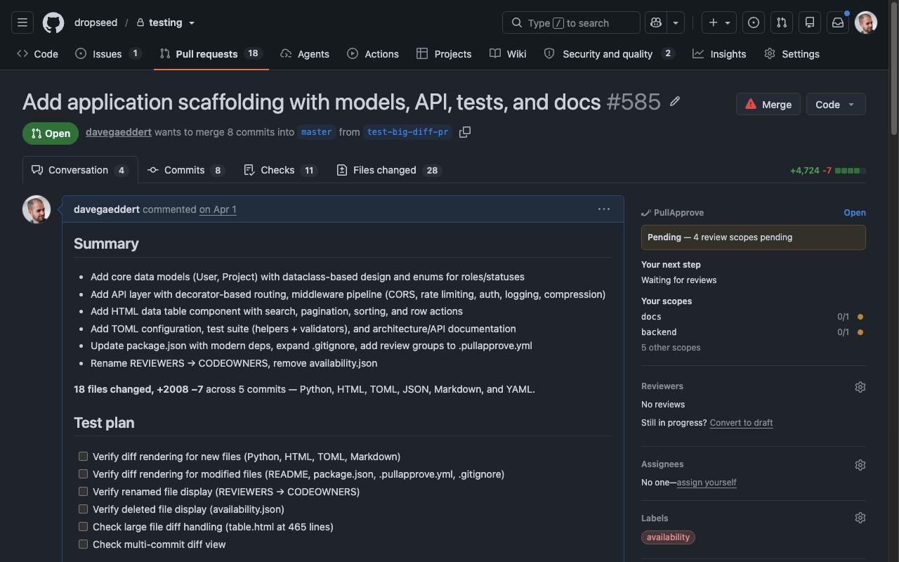
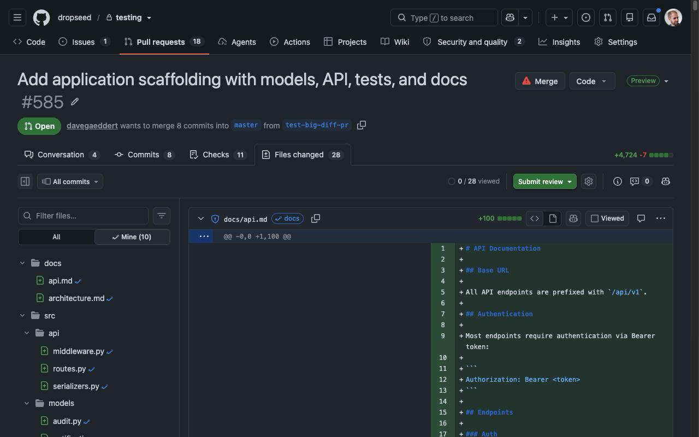

# pullapprove-browser-extension

This browser extension embeds PullApprove information directly into the GitHub UI.

[](https://chrome.google.com/webstore/detail/pullapprove/jfcmjfiigpabjhaacjpnlihifgfodjhj)

When viewing a pull request you'll see the PullApprove review status, next
steps, and scopes at the top of the sidebar, with a link through to the full
review in PullApprove. Pull requests on PullApprove v3 keep the report
summary the extension has always shown (`components/v3`); PullApprove 5
support lives separately in `components/v5`.

On the "Files changed" tab, files in your PullApprove scopes are marked, and an
**All / Mine** toggle under the file filter hides everything else,
so you can review just what's yours without leaving GitHub.





To use it, connect the extension to your PullApprove account once in each
browser: open a pull request and click **Connect** in the PullApprove sidebar,
or go to https://5.pullapprove.com/extension/connect/. To disconnect a
browser, go to **My account** on PullApprove.

## Development

```
npm install
npm run build        # or `npm start` to rebuild on change
```

Then in Chrome open `chrome://extensions`, turn on **Developer mode**, click
**Load unpacked**, and pick this directory. An unpacked build reloads itself
when `dist/content.js` changes, so after a rebuild just refresh the GitHub tab
(twice: the first request is what notices the new build). That only watches
`dist/content.js`: after changing `connect.js`, reload the extension from
`chrome://extensions` yourself.

Firefox gets its own build: `./scripts/build-firefox` writes `build/firefox`
with a manifest that declares `background.js` as a background script (Firefox
runs no service workers) and the add-on id and data collection declaration
AMO requires. Chrome warns about those keys, which is why they aren't in
`manifest.json`. Then open `about:debugging#/runtime/this-firefox`, click
**Load Temporary Add-on…**, and pick `build/firefox/manifest.json`; the
add-on is gone when Firefox quits. `npx web-ext lint --source-dir
build/firefox` checks it against what Firefox and AMO accept.

### Reproducible build

The release zips are built from this repository with Node and npm only; no
other tools are needed. Any operating system that runs Node works (releases
are built on macOS).

1. Install Node v24.21.0 and npm 11.19.0, for example from
   https://nodejs.org/ or with `fnm install 24.21.0` / `nvm install 24.21.0`.
2. In this directory: `npm install` (installs Parcel 2, which bundles the
   React components; versions are pinned by `package-lock.json`).
3. `./scripts/build-firefox`

Step 3 runs `npm run build` (`parcel build content.js connect.js --no-cache
--no-source-maps`), which writes `dist/content.js` and `dist/connect.js`,
then copies `dist`, `img`, `LICENSE` and `background.js` into
`build/firefox`, writes the Firefox manifest there (Chrome's `manifest.json`
with `background.scripts` and `browser_specific_settings` added), and zips
it as `pullapprove-browser-extension-firefox.zip`. The Chrome zip is the
same files with the unmodified `manifest.json`.

Everything outside `dist` and `build` is hand-written source; `dist` is the
only generated output.

Safari needs a wrapper app, which lives in `safari/` as an Xcode project
(generated once with `xcrun safari-web-extension-converter`, then kept in
git). `./scripts/build-safari` builds the extension, copies it into the
project's `PullApprove Extension/Resources` folder (gitignored; it's a copy),
and archives the Release configuration. `./scripts/upload-safari` sends that
archive to App Store Connect, where it's distributed through the Mac App
Store. Both scripts sign with the Apple account signed into Xcode.

Build the Release configuration: a Debug build splits the extension into a
stub plus a debug dylib that a sandboxed extension can't load, and Safari
then silently hides it. To run an unsigned local build, Safari must have
**Allow unsigned extensions** turned on (it resets every launch).
